# RTCollisionDetection
This package implements mesh-to-mesh and mesh-to-robot-sphere-swept-volume collision detection algorithms using [NVIDIA OptiX](https://developer.nvidia.com/rtx/ray-tracing/optix).

<table align="center">
  <tr>
    <td>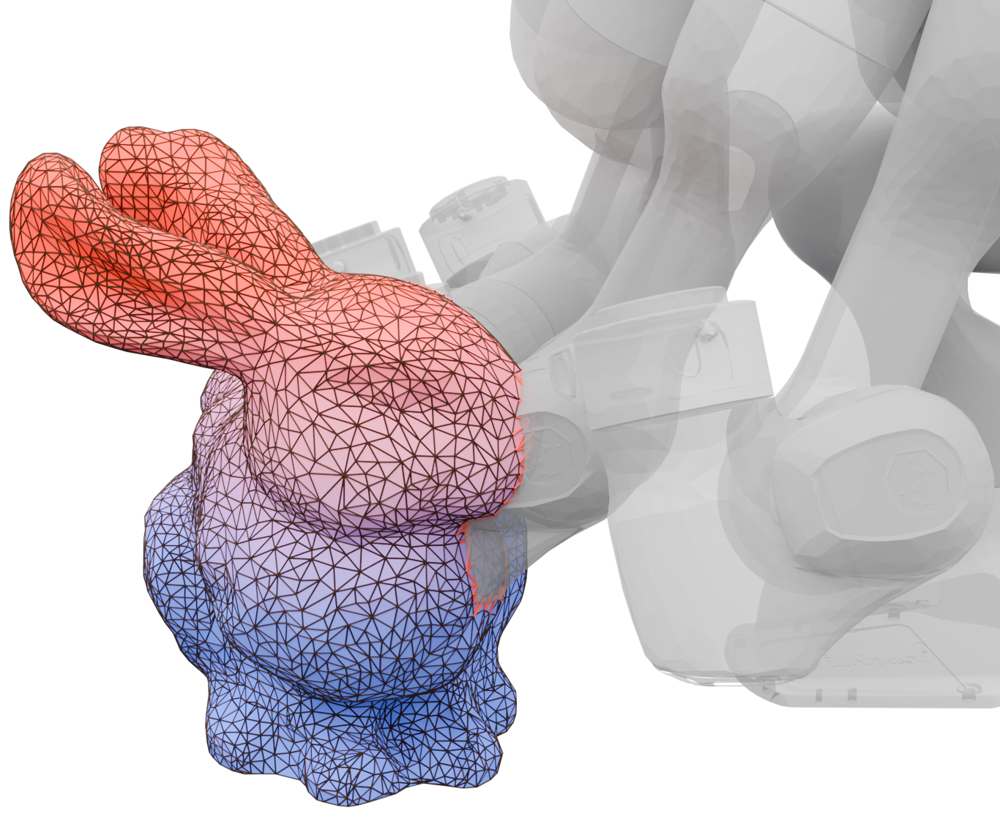</td>
    <td>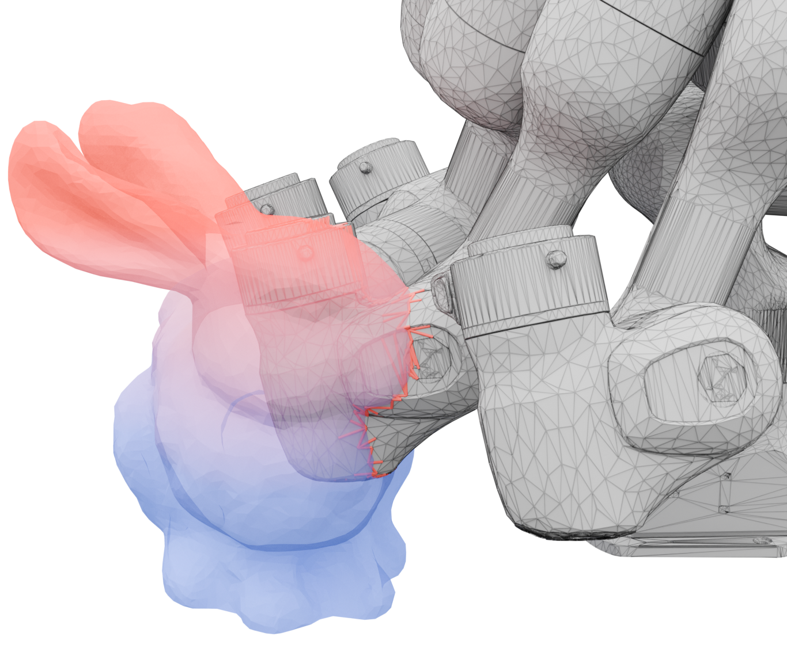</td>
    <td>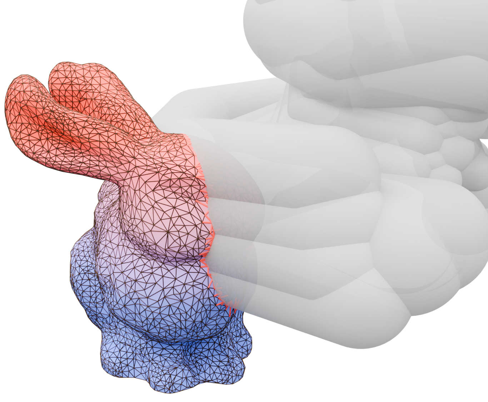</td>
    <td>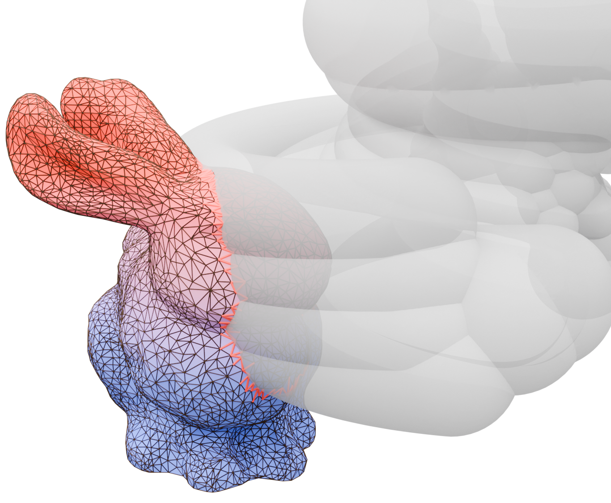</td>
  </tr>
  <tr>
    <td align="center">(a)</td>
    <td align="center">(b)</td>
    <td align="center">(c)</td>
    <td align="center">(d)</td>
  </tr>
</table>

<p align="center">
  <em>Ray tracing collision detection methods: discrete-pose collision detection by ray-tracing (a) along obstacle meshes and (b) along robot meshes, and continuous collision detection by ray-tracing against swept sphere-approximated robot volumes (c) piecewise-linear paths or (d) quadratic B-spline paths.</em>
</p>

> **Layout.** Public headers in `include/rtcd/`, implementation in `src/`, executables in `apps/`, tests and their
> committed reference data in `tests/`, JSON configuration in `configs/`. This library replaced the original
> header-only, template-configured code under `RTCD/` (the "old stack"), which has been removed; its last commit is
> tag `old-stack-final`. Before the removal the new code reproduced the old stack's collision flags on all four
> regression references and ran at the same speed (see [Status](#status)); the old stack's results are kept as
> stored references in `tests/data/`.

## Contents
- [TODO](#todo)
- [Features](#features)
- [What the library does](#what-the-library-does)
- [Requirements](#requirements)
- [Build](#build)
- [Usage](#usage)
- [Set up a new robot](#set-up-a-new-robot) (full rules and the sphere-generation tool: [docs/How-to-New-Robot.md](docs/How-to-New-Robot.md))
- [Set up a new mesh collision scene](#set-up-a-new-mesh-collision-scene)
- [Benchmarks](#benchmarks) (details, cuRobo / FCL comparison, plotting: [docs/Benchmark.md](docs/Benchmark.md))
- [Status](#status)
- [Known limitations and findings](#known-limitations-and-findings)
- User documentation: [configuration reference](docs/user/configuration.md), [architecture in one page](docs/user/architecture.md); design contract: [docs/design/interfaces.md](docs/design/interfaces.md)

## TODO
- [x] Upload the source code.
- [x] Robot loaded at runtime from its URDF (no hand-written robot header). See [Set up a new robot](#set-up-a-new-robot).
- [x] URDF parser / sphere-generation tool (`scripts/URDFParser`, [docs/How-to-New-Robot.md](docs/How-to-New-Robot.md)).
- [x] Runtime configuration from JSON (checker, scene, robot) instead of compile-time template parameters.
- [x] Port to OptiX 9.1 / CUDA 13.2 (tested on an RTX 5080).
- [x] Delete the old stack under `RTCD/` (last commit: tag `old-stack-final`).
- [x] Demos on the new stack (`rtcd_demo_discrete`, `rtcd_demo_curve`).
- [ ] Build and test on Linux and with compilers other than MSVC.
- [ ] Reference results for cubic B-spline curves.
- [ ] Spline weight files for `"phantom"` end points.
- [ ] Merge RobotToObs and ObsToRobot (Two-way method)
- [ ] Upload modified GVDB.
- [ ] Enable self-collision
- [ ] Adapt curve representation for Blackwell Architecture

## Features
### **Mesh-to-mesh** collision detection with ray-tracing method.

<table align="center">
  <tr>
    <td></td>
    <td></td>
  </tr>
  <tr>
    <td align="center">ObsToRobot</td>
    <td align="center">RobotToObs</td>
  </tr>
</table>

<table align="center">
  <tr>
    <td>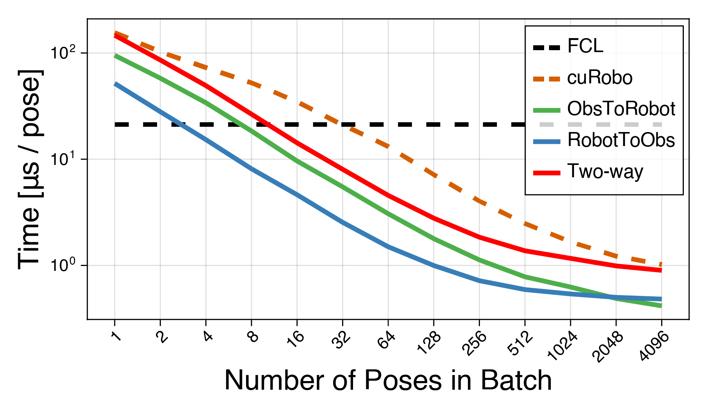</td>
    <td>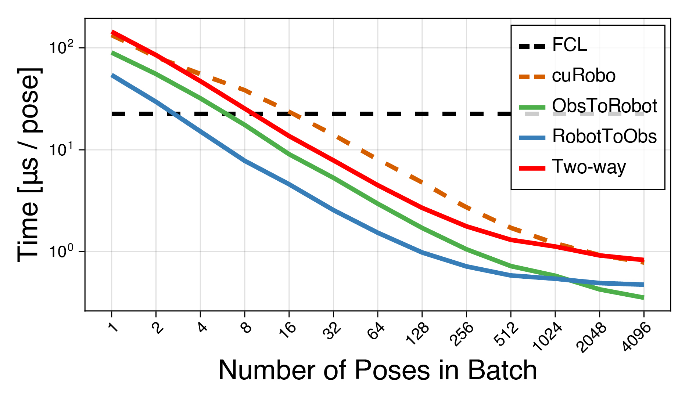</td>
    <td>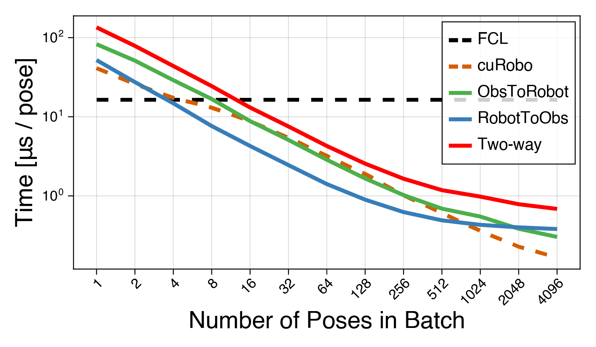</td>
  </tr>
  <tr>
    <td align="center">Dense Scene</td>
    <td align="center">Medium Scene</td>
    <td align="center">Simple Scene</td>
  </tr>
</table>
<p align="center">
  <em>Despite performing a much more complex collision check than cuRobo</em> (<b>mesh-to-mesh vs. mesh-to-sphere</b>), <em>our methods outpaced cuRobo by</em> <b>up to 2.8x</b> <em>on medium to dense scenes, scaling past CPU performance at smaller batch sizes.</em>
</p>

### **Swept-volume of sphere represented robot** collision deteciton with mesh obstacles.
<p align="center">
  
</p>
<table align="center">
  <tr>
    <td>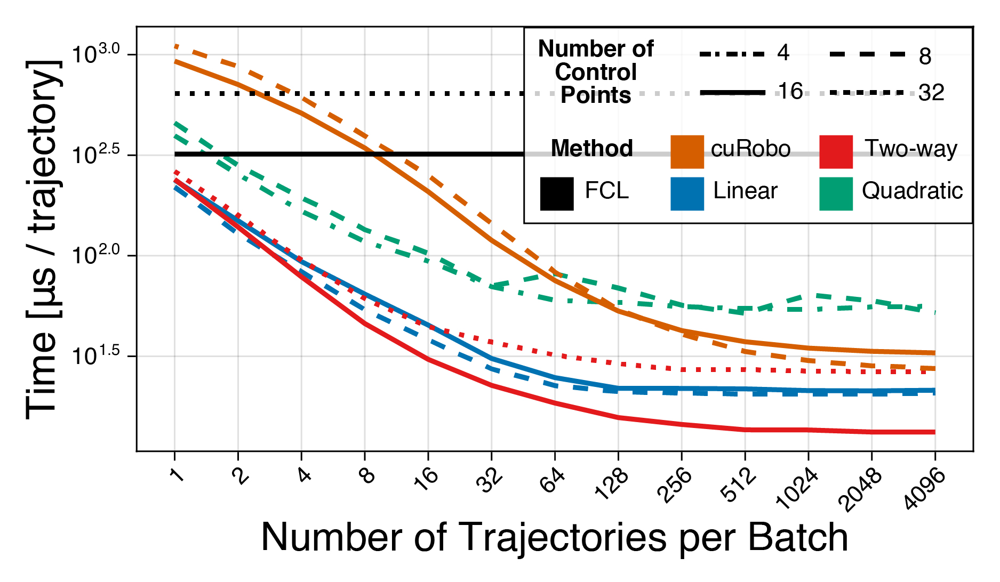</td>
    <td>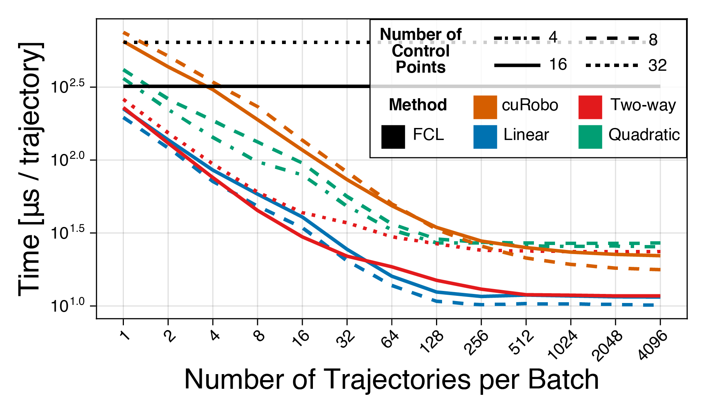</td>
    <td>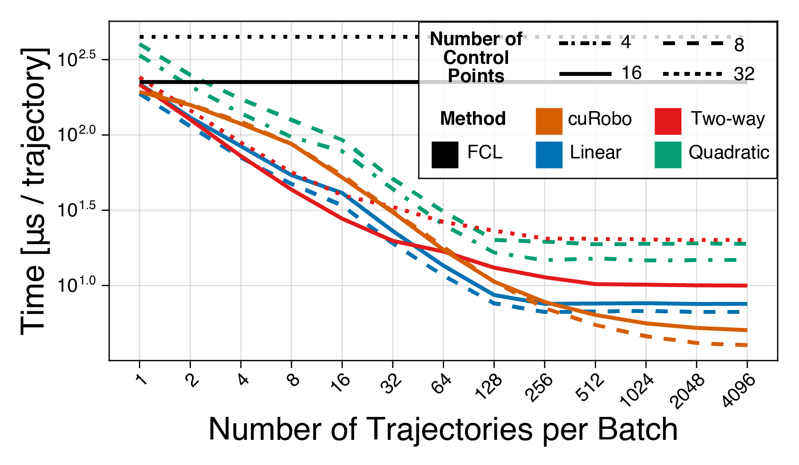</td>
  </tr>
  <tr>
    <td align="center">Dense Scene</td>
    <td align="center">Medium Scene</td>
    <td align="center">Simple Scene</td>
  </tr>
</table>
<p align="center">
  <em>Our piecewise-linear and discretized methods outpaced cuRobo on all except large batch sizes on simple scenes, with discretization being the fastest on dense scenes at the cost of recall rate. Quadratic B-splines had the best accuracy at slower speeds, but were still faster than cuRobo at most batch sizes for medium/dense scenes.</em>
</p>

> The result figures above were measured on an **RTX 4070 under Linux with the original code** (the old stack,
> before the OptiX 9.1 port and the restructuring). They have not been re-measured with the current code.

## What the library does
RTCD checks a batch of robot configurations against a static scene of triangle-mesh obstacles and returns one
collision flag per item. An **item** is either one pose (discrete modes) or one trajectory of a fixed number of
poses (continuous modes). The robot is a serial chain loaded from a URDF; obstacles are OBJ meshes. Each checker
runs in exactly one mode for its lifetime (`"mode"` in the checker config):

| `mode` | figure | item | what is ray traced |
|---|---|---|---|
| `"mesh"` (ObsToRobot) | (a) | one pose | the edges of the scene obstacles, as rays, against a per-batch instance acceleration structure of the robot link meshes (one instance per pose and link) |
| `"ray"` (RobotToObs) | (b) | one pose | the edges of the robot link meshes, moved to each pose, as rays against the scene's instance acceleration structure |
| `"linear_curve"` | (c) | one trajectory | the scene edges against the robot's spheres swept along the trajectory as OptiX round linear curves |
| `"quadratic_curve"` | (d) | one trajectory | as linear, with each sphere's path fitted by a quadratic B-spline (round quadratic B-spline curves) |
| `"cubic_curve"` | -- | one trajectory | as quadratic, cubic B-splines; implemented but without reference results (see [limitations](#known-limitations-and-findings)) |

An item collides when at least one ray reports a hit for it. The flags are the result; per-item hit counts can be
returned too but are diagnostic only (they depend on the mode, geometry flags and early-exit options and may be
lower bounds). Work is split into batches of up to `max_batch_size` items spread over `streams` CUDA streams.
Before tracing, the discrete modes cull links whose oriented bounding box (OBB) does not overlap any obstacle OBB
(`obb_culling`, on by default for `mesh` and `ray`, off by default for the curve modes).

**Choosing a mode.** For single poses use `mesh` or `ray`; for motions between poses use a curve mode. The two
discrete modes trace different edge sets (obstacle edges vs. robot edges), so they do not report identical flags:
on the 4096 regression poses (Panda, medium shelf) `mesh` reports 1365 colliding poses and `ray` 1383. The curve
modes need the robot's sphere approximation; on the 4096 regression trajectories `linear_curve` reports 2895 and
`quadratic_curve` 2847 collisions. Quadratic and cubic curves additionally need a spline weight file for the chosen
control / trajectory point counts. The relative speed of the modes is shown by the figures above (old code, RTX
4070); measure on your own hardware with the [benchmarks](#benchmarks).

## Requirements
Tested (the only configuration the library has been built and run on):
- Windows 11, Visual Studio 2026 with MSVC 14.52, Ninja, Release build (CMake >= 3.25 is required);
- CUDA Toolkit 13.2; OptiX SDK 9.1.0; an RTX 5080 (an RTX GPU is required: OptiX hardware ray tracing);
- vcpkg (triplet `x64-windows`) with the packages the CMake files look for:
  ```bash
  vcpkg install eigen3 urdfdom urdfdom-headers benchmark nlohmann-json gtest
  ```
  (Earlier instructions also listed `lz4 tbb flann imgui glfw3` and OpenGL; no CMake file looks for them any
  more.) `tiny_obj_loader.h` is downloaded at configure time, pinned to a fixed commit and hash
  (`cmake/configure_tiny_obj_loader.cmake`).

The Python tools (`scripts/URDFParser`, `scripts/Benchmark/curobo`) need the packages of `requirements.txt`
(`pip install -r requirements.txt`); the plotting scripts need Julia (`scripts/Project.toml`).

Not tested: Linux (the CMake files still have Linux branches, but the library has never been built there), other
compilers, Debug builds, other GPUs, other CUDA / OptiX versions (CMake accepts CUDA >= 12.6).

OptiX is found through `OptiX_INSTALL_DIR` (CMake variable or environment variable) or the environment variable
`OptiX_ROOT_DIR`; on Windows, without either, CMake searches `C:/ProgramData/NVIDIA Corporation/OptiX SDK*`
(set `OptiX_INSTALL_DIR` if several SDKs are installed).

## Build
From a Visual Studio x64 developer command prompt (`vcvars64.bat`), in the repository root:
```bat
cmake -S . -B build -G Ninja -DCMAKE_BUILD_TYPE=Release -DBUILD_TESTS=ON ^
      -DCMAKE_TOOLCHAIN_FILE=<vcpkg root>/scripts/buildsystems/vcpkg.cmake -DVCPKG_TARGET_TRIPLET=x64-windows ^
      -DCMAKE_CUDA_FLAGS=-D_ALLOW_COMPILER_AND_STL_VERSION_MISMATCH
cmake --build build --target AllNew
```
This is the configure line the library is built with. `_ALLOW_COMPILER_AND_STL_VERSION_MISMATCH` is needed
because MSVC 14.52's standard library rejects the CUDA 13.2 compiler otherwise (error STL1002; the project's own
CUDA targets also get it from `cmake/configCompilerFlags.cmake`).

CMake options and targets:

| | |
|---|---|
| `-DBUILD_TESTS=ON` | configure the tests (default `OFF`); needed for `ctest` |
| `AllNew` | every target: libraries, apps, tests (with `BUILD_TESTS=ON`), compile-only header checks |
| `rtcd` | the library to link (an INTERFACE target over the detector, the three backends, config and JSON modules) |
| `rtcd_example` | the [minimal example](#usage) |
| `rtcd_regression` | the golden regression, driven by a setup file |
| `rtcd_bench_discrete`, `rtcd_bench_curve` | the Google Benchmark apps |
| `rtcd_demo_discrete`, `rtcd_demo_curve` | the demos (random poses / trajectories on the dense shelf, `configs/setups/demo_<mode>.json`) |

Executables go to `build/bin/apps`, tests to `build/bin/Tests/new`.

Tests, from `build/` (tests run with the repository root as working directory):
```bash
ctest -L new_unit     # no GPU needed
ctest -L new_gpu      # on the GPU, including the golden regression, the stored references and the app smoke tests
ctest -L regression   # only the golden regression: rtcd_regression_<ias|ray|linear|quad> (+ ray hit modes, quad
                      # with geometry flags none); a subset of new_gpu
```
Everything the tests read is in the repository: the regression goldens
`tests/data/CCTest/golden_{ias,ray,linear,quad}.bin`, the cached poses / KNN trajectories under
`tests/data/motions`, and the stored outputs of the removed old stack under `tests/data/reference`
([tests/data/README.md](tests/data/README.md): what each file is, how it was produced, and why goldens and references
are never regenerated casually). `RTCD_DATA_DIR` (or `--data <dir>` for the apps) points at another folder with the
same layout. The local, gitignored `data/` folder only receives benchmark results and plots.

## Usage
### Minimal example
[`apps/example/example.cpp`](apps/example/example.cpp) is the whole program (built and run by `ctest -L new_gpu`
on all four regression setups); below is that file without its header comment:

```cpp
#include <rtcd/rtcd.h>

#include <cstdio>
#include <memory>
#include <vector>

int main(int argc, char** argv) {
    try {
        // 1. Checker config, scene description and robot description; relative paths in the JSON files are
        //    resolved against the file that contains them.
        const rtcd::Setup setup = rtcd::loadSetup(argc > 1 ? argv[1] : "configs/setups/regression_ias.json");

        // 2. GPU context, robot (URDF + link meshes [+ spheres]), scene (obstacle meshes on the GPU), checker.
        std::shared_ptr<rtcd::Context> context        = rtcd::Context::create();
        std::shared_ptr<const rtcd::RobotModel> robot = rtcd::RobotModel::load(setup.robot);
        std::shared_ptr<const rtcd::Scene> scene      = std::make_shared<rtcd::Scene>(context, setup.scene);
        rtcd::CollisionChecker checker(context, setup.checker, robot, scene);

        // 3. Items, packed as [item][waypoint][joint] float32 radians. Item i covers the stretch
        //    [i, i + 1] / numItems of the straight line from the lower to the upper joint limits (a discrete
        //    item is the midpoint of its stretch).
        const rtcd::ItemLayout layout = checker.itemLayout(); // dof, pointsPerItem (1 for discrete modes)
        const std::size_t numItems    = 8;
        std::vector<float> items;
        for (std::size_t i = 0; i < numItems; ++i) {
            for (std::uint32_t p = 0; p < layout.pointsPerItem; ++p) {
                const float u = layout.pointsPerItem > 1 ? float(p) / float(layout.pointsPerItem - 1) : 0.5f;
                const float t = (float(i) + u) / float(numItems);
                for (std::uint32_t j = 0; j < layout.dof; ++j) {
                    const float lo = robot->lowerLimits()[j], hi = robot->upperLimits()[j];
                    items.push_back(lo + t * (hi - lo));
                }
            }
        }

        // 4. Check (blocking) and print the flags.
        const rtcd::CheckResult result = checker.check(rtcd::HostItems{items, numItems});
        for (std::size_t i = 0; i < numItems; ++i) {
            std::printf("item %zu: %s\n", i, result.collides[i] ? "collision" : "free");
        }
        std::printf("%zu of %zu items collide (robot '%s', dof %u, scene '%s')\n", result.numColliding(), numItems,
            robot->name().c_str(), robot->dof(), setup.scene.name.c_str());
        return 0;
    } catch (const rtcd::Error& e) { // ConfigError, IoError, CapacityError, UnsupportedError, CudaError, ...
        std::fprintf(stderr, "rtcd_example: %s\n", e.what());
        return 1;
    }
}
```
Run it from the repository root with any setup file, e.g.
`build\bin\apps\rtcd_example.exe configs\setups\regression_quad.json`; the last line it prints is
`3 of 8 items collide (robot 'panda', dof 7, scene 'shelf')`.

To use the library from your own CMake target inside this tree, link `rtcd` (see `apps/example/CMakeLists.txt`).
There is no install / package export yet.

### The API in short
All public headers are plain C++20 (no CUDA or OptiX headers); `#include <rtcd/rtcd.h>` includes all of them.
- `Context::create()` owns the CUDA device, the OptiX device context, a stream pool and the `Logger`.
- `RobotModel::load(RobotDesc)` is host only (no GPU needed); `Scene(context, SceneDesc)` builds the obstacles on
  the GPU. Both are immutable and can be shared by several checkers (a scene only by checkers on its Context).
- `CollisionChecker(context, config, robot, scene)` validates the config against robot and scene and allocates
  everything once, for the capacities `max_batch_size` and `max_items_per_check`.
- `check(HostItems)` -> `CheckResult` (`collides`, optionally `hitCounts`); an overload writes into caller spans
  without allocating; `checkDevice(DeviceItems, DeviceSpan<uint32_t>)` takes and returns device memory (the path
  the benchmarks time); `warmup()`; `lastStats()`; `config()` returns the resolved configuration actually used.
- Input layout: float32 radians, item `i` at float `i * stride` (`stride = 0` means packed), waypoints of a
  trajectory consecutive, joints in chain order root to tip (`RobotModel::jointNames()`). The checker does not
  clamp or check joint values against the limits.
- Errors are exceptions derived from `rtcd::Error` (`ConfigError`, `IoError`, `CapacityError`, `InvalidArgument`,
  `UnsupportedError`, `CudaError`, `OptixError`), in every build type; library code never calls `exit()`. A
  `CapacityError` / `InvalidArgument` from `check()` is raised before any GPU work and leaves the checker usable.
- A `CollisionChecker` is not thread-safe (serialize calls on one checker); different checkers may run
  concurrently, also when they share a Context, robot or scene.

### Configuration files
A **setup file** names the three parts of one experiment; each value is a path (relative to the setup file) or
the object itself inline (`configs/setups/regression_quad.json`):
```json
{ "checker": "../checker_quad.json", "scene": "../scenes/shelf.json", "robot": "../robots/panda.json" }
```

A **checker config** holds every option of a `CollisionChecker`. Unspecified keys get their defaults, unknown keys
are errors. A small example:
```jsonc
{
  "mode": "quadratic_curve",          // mesh | ray | linear_curve | quadratic_curve | cubic_curve
  "streams": 4,                       // CUDA streams; batch b runs on stream b % streams
  "max_batch_size": 128,              // items per batch (capacity)
  "max_items_per_check": 4096,        // items per check() call (capacity)
  "curve": {
    "trajectory_points": 16,          // poses per trajectory item (fixed for the checker)
    "control_points": 8,              // B-spline control points per sphere path (quadratic / cubic)
    "spline_weights_dir": "spline_weights"  // holds quad/normal/8_16.txt, relative to this file
  }
}
```
(The comments are for this README only: the loader does not accept comments in JSON.) Every key, its type,
default and meaning: [docs/user/configuration.md](docs/user/configuration.md). `configs/checker_{ias,ray,linear,quad}.json`
are the four regression configurations, with most keys spelled out explicitly.

A **scene file** lists the obstacles (see [Set up a new mesh collision scene](#set-up-a-new-mesh-collision-scene)),
a **robot file** says where the URDF and the link geometry are (see [Set up a new robot](#set-up-a-new-robot)).

Configs can be changed without editing files: `rtcd::applyOverrides(config, "mode=ray,ray.hit_mode=traverse")`
takes `dotted.path=value` pairs of the checker schema; `rtcd_regression --override "..."` and the environment
variable `RTCD_OVERRIDES` (read by the regression and benchmark apps, never by the library) use the same syntax.
`rtcd::dumpCheckerConfig(checker.config())` returns the resolved configuration, every field, as JSON text.

### Golden regression
`rtcd_regression --setup configs/setups/regression_<ias|ray|linear|quad>.json` runs the checker on the cached
regression inputs and checks determinism, prefix consistency (the first N items alone give the same flags) and the
flags against `tests/data/CCTest/golden_<mode>.bin` (exit code 0 = all passed; `ctest -L regression` runs it). Options: `--engine auto|checker|reference`,
`--override "k=v,..."`, `--golden <file>` / `--no-golden`, `--items N`, `--data <dir>`, `--dump-flags <file>`.

## Set up a new robot
A robot is loaded at run time from its URDF plus a mesh per link and, for the curve modes, a sphere file per link,
referenced from a robot file (`configs/robots/panda.json`):
```json
{
  "robot": {
    "description": "../../models/franka_description/panda.urdf",
    "geometry": {
      "mesh":    { "dir": "../../models/franka_description/meshes/Simplified/watertight", "format": "obj", "source": "visual" },
      "spheres": { "dir": "../../models/franka_description/spheres", "format": "xyzr" }
    }
  }
}
```
Nothing is generated or compiled per robot. Serial chains of revolute / continuous joints (fixed joints merged),
1 to 16 DOF; meshes in meters; each link's mesh is `<mesh dir>/<file name of the URDF mesh>`; sphere files are
`<spheres dir>/<link name>.txt` with one `x y z r` line per sphere. The full rules, and how to generate sphere files
with the URDF parser tool in `scripts/URDFParser` (Python, `requirements.txt`), are in
**[docs/How-to-New-Robot.md](docs/How-to-New-Robot.md)**. Check a new robot without a GPU with
`rtcd::RobotModel::load(rtcd::loadRobotDesc("my_robot.json"))`; only the Franka Panda has been tested.
## Set up a new mesh collision scene
A scene file lists the obstacles (`configs/scenes/shelf_simple.json`):
```json
{
  "name": "shelf_simple",
  "obstacles": [
    { "name": "shelf", "mesh": "../../models/curobo/shelves.obj", "scale": 1.0, "pose": { "translation": [0.45, 0.0, 0.4] } },
    { "name": "bin1", "mesh": "../../models/curobo/bin.obj", "pose": { "translation": [0.0, -0.6, 0.0] } },
    { "name": "bin2", "mesh": "../../models/curobo/bin.obj", "pose": { "translation": [0.0, 0.6, 0.0] } }
  ]
}
```
- `mesh` (required): an OBJ file, relative to the scene file; triangulated on load.
- `scale` (> 0, default 1): uniform, applied before the pose: `world = pose * (scale * v)`.
- `pose` (default identity): `"translation": [x, y, z]` plus at most one rotation: `"rpy": [roll, pitch, yaw]`
  (radians, URDF convention), `"quaternion": [x, y, z, w]`, or `"matrix"`: 12 numbers, row-major 3x4 `[R | t]`
  (then without `"translation"`).
- `name` (default: the mesh file name without extension) is used in messages.
- The scene must have at least one obstacle. Obstacles are static: a scene is built once and is immutable.

Edge sets: the `mesh` and curve modes shoot rays along obstacle edges. `"scene_edges": "unique"` uses every unique
triangle edge; `"loop"` (the default for the curve modes) uses consistently oriented edge loops, which exist only
when **every obstacle mesh is watertight**; otherwise constructing a checker that uses loop edges fails with an
`UnsupportedError` naming the first non-watertight obstacle (use watertight meshes or set `"scene_edges": "unique"`).
The three benchmark scenes are `configs/scenes/shelf_simple.json`, `shelf.json` (the "medium shelf" of the
goldens) and `shelf_dense.json`.

## Benchmarks

### Collision Scene
<p align="center">
  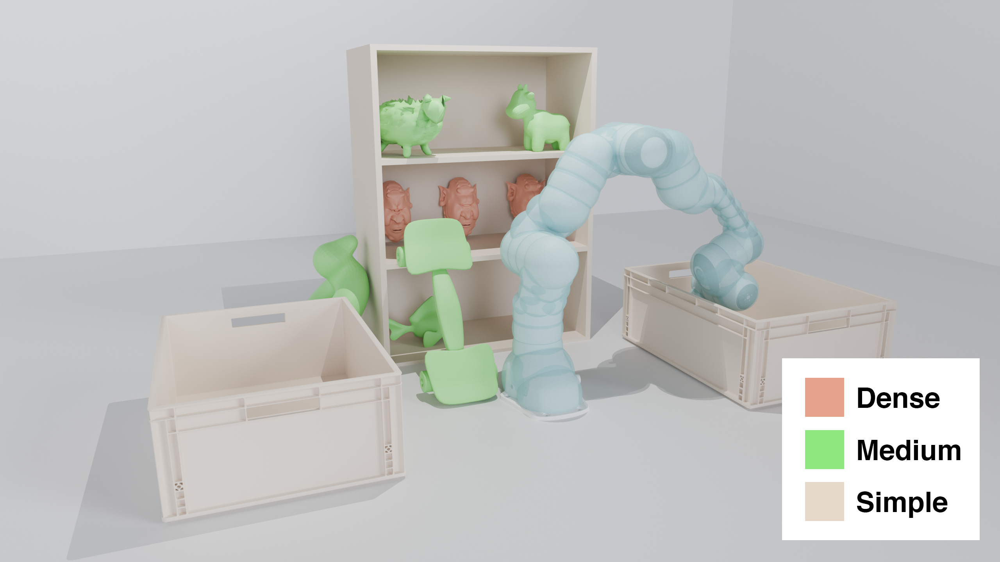
</p>

<p align="center">
  <em>All benchmark is carried out in a scene like this. The simple, medium, and dense versions of the scene consisted of over 15k / 22k, 71k / 107k, and 191k / 321k triangles / edges, respectively.</em>
</p>

### RTCD Benchmarks
The Google Benchmark apps `rtcd_bench_discrete` (poses) and `rtcd_bench_curve` (trajectories) time
`CollisionChecker::checkDevice` on the committed inputs of `tests/data/motions`; the scene is a runtime option
(`--scene`). The scripts in the repository root run both over the three scenes and write the JSON results to
`data/Benchmark/result/{discrete,curve}/`, where the plotting scripts read them:
```bash
./benchmark.sh  [--only discrete|curve] [--build <dir>] [--out <dir>] [-- <Google Benchmark args>]   # Linux
```
```bat
.\benchmark.bat [--only discrete|curve] [--build <dir>] [--out <dir>] [--no-pause] ["<GB arg>" ...]
```
On Windows invoke the batch file with a path (`.\benchmark.bat`): PowerShell does not run a script from the
current directory by its bare name. App options, the cuRobo and FCL comparisons and plotting (Julia):
**[docs/Benchmark.md](docs/Benchmark.md)**. Running the whole suite takes a while.
## Status
Measured on Windows, RTX 5080, Release build:
- **Correctness.** Through the public `CollisionChecker`, the library reproduces all four goldens (recorded with
  the old stack) with zero differing flags: mesh 1365, ray 1383, linear curves 2895, quadratic curves 2847
  colliding items of 4096 (Panda, medium shelf). Ray mode matches in all four ray hit modes, quadratic curves with
  both curve geometry flags, and the curve modes also with OBB culling on. Below the flags, the stored outputs of
  the old stack (kinematics table, FK and curve kernels, meshes, scene edge rays, OBB overlap counts, IAS hit counts,
  refit behaviour; `tests/data/reference`) are reproduced bit for bit.
- **Speed.** Before the old stack was removed, old and new were timed in the same process (side-by-side runner,
  medium shelf): median time new / old = 0.97-1.01 (mesh), 0.87-0.97 (ray), 0.98-1.08 (linear curves), 0.98-1.04
  (quadratic curves).

## Known limitations and findings
- **Cubic curves have no reference results.** `cubic_curve` is implemented and its results are deterministic, but
  no golden exists to check its flags against; `"obb_culling": true` is rejected for it (as in the old stack).
- **Refit policies other than the default can change grazing results.** `curve.refit` trades GAS build cost
  against trace cost; a refitted GAS can flip grazing hits. With `{"every": 3}` the quadratic regression reports
  two extra collisions (items 4065 and 3528 at N = 4096), in the old and the new stack alike; no flip was seen under
  `"auto"`, `"always"` or `"never"` in 324 compared checks. The goldens use `"auto"` (the default).
- **The old stack's quadratic OBB culling was wrong; it is fixed here.** The old quadratic segment OBB construction
  could produce boxes that do not contain their curve segment, so OBB culling dropped hits (it was never covered by
  a golden: the curve goldens run with culling off). The current boxes contain their segments, and OBB culling on
  reproduces the culling-off flags for linear and quadratic curves.
- **Small batches are bound by host-side driver overhead on Windows.** Each CUDA / OptiX host call costs on the
  order of 5-30 us in the driver on this machine, so at small batch sizes the time per check is dominated by the
  number of host calls, not by GPU work.
- Trajectory and control point counts are fixed per checker; quadratic / cubic curves need the weight file
  `<spline_weights_dir>/<quad|cubic>/<normal|repeated>/<control>_<trajectory>.txt`, and
  `control_points * trajectory_points <= 512`. `configs/spline_weights` holds the existing files; there are none
  for `"phantom"` end points, so that setting fails at checker construction.
- More items than `max_items_per_check` in one call is a `CapacityError` (no automatic splitting into rounds).
- No self-collision checking; obstacles are static.

## Disclaimers
The code contained herein is of "research grade". The library under `include/rtcd/` and `src/` is documented and
tested against the original results, but it has been built and run on one machine and one robot only (see
[Requirements](#requirements)). The original code (`RTCD/`, removed) is available at tag `old-stack-final`.

Further development is ongoing. For upcoming features and demos, please refer to the TODO list.

## Acknowledgements
This project is based on the following projects:
- Official OptiX SDK samples shipped with OptiX
- [optix7course](https://github.com/ingowald/optix7course)

## Citing
This repository was developed at the [Human Centered Robotics Lab (HCRL)](https://sites.utexas.edu/hcrl/) of The University of Texas at Austin in collaboration with Dexterity, Inc. by [Sizhe Sui](https://ssz990220.github.io/), advised by [Prof. Luis Sentis](https://scholar.google.com/citations?user=-3pL5qkAAAAJ&hl=en) and [Andrew Bylard](https://scholar.google.com/citations?user=wKr1q1IAAAAJ&hl=en).

If you found this repository useful, please cite our paper:
- [1] **Conference Paper:** S Sui, L Sentis, and A Bylard, *Hardware-Accelerated Ray Tracing for Discrete and Continuous Collision Detection on GPUs.* **IEEE International Conference on Robotics and Automation (ICRA)** 2025. Available: [https://www.arxiv.org/abs/2409.09918](https://www.arxiv.org/abs/2409.09918)
