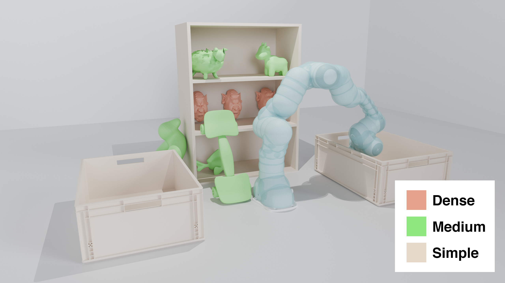

# Benchmarking

## Scene structure

<div align="center">


<p><em>All benchmarks run in a scene like this. Scene complexity (triangles / edges):<br>
Simple: 15k / 22k &nbsp;&nbsp;|&nbsp;&nbsp; Medium: 71k / 107k &nbsp;&nbsp;|&nbsp;&nbsp; Dense: 191k / 321k</em></p>

</div>

The three scenes are `configs/scenes/shelf_simple.json`, `shelf.json` (medium, the scene of the goldens) and
`shelf_dense.json`.

## RTCD benchmark

The Google Benchmark apps are `rtcd_bench_discrete` (poses, modes `mesh` and `ray`: `BM_IAS`, `BM_RAY`) and
`rtcd_bench_curve` (trajectories: `BM_LINEAR`, `BM_QUAD`, `BM_MESH`, `BM_RAY` over discretized trajectories), built
by the target `AllNew` into `build/bin/apps`. They time `CollisionChecker::checkDevice` on poses or KNN trajectories
sampled from the committed inputs under `tests/data/motions` (8192 poses and their 4 nearest neighbours; nothing
is generated). The scene is a runtime option, so one executable serves all three scenes:
```bash
build/bin/apps/rtcd_bench_discrete --scene configs/scenes/shelf_dense.json --benchmark_out=<file>.json
```
App options: `--scene <scene.json | shelf | shelf_simple | shelf_dense>` (default `configs/scenes/shelf.json`),
`--robot <robot.json>` (default `configs/robots/panda.json`), `--data <dir>` (default: env `RTCD_DATA_DIR`, else
`tests/data`); every other argument goes to Google Benchmark. The environment variable `RTCD_OVERRIDES`
(`"path=value,..."`) changes the checker configs they build; `RTCD_OPTIX_CFG`, `RTCD_CURVE_GEOM_FLAG` and
`RTCD_BM_REFIT_EVERY` are the old benchmarks' knobs (`tests/support/options.h`).

The scripts in the repository root run both apps over the three scenes and write the JSON where the plotting
scripts read it:
```bash
./benchmark.sh  [--only discrete|curve] [--build <dir>] [--out <dir>] [-- <Google Benchmark args>]   # Linux
```
```bat
.\benchmark.bat [--only discrete|curve] [--build <dir>] [--out <dir>] [--no-pause] ["<GB arg>" ...]
```
- On Windows invoke the batch file **with a path** (`.\benchmark.bat`): PowerShell does not run a script from the
  current directory by its bare name. Quote Google Benchmark arguments that contain `=` (`"--benchmark_filter=BM_IAS"`):
  `cmd` splits on it.
- `--build` (default `./build`): executables are looked up in `<build>/bin/apps`, or `<build>/bin/apps/Release`
  for the Visual Studio generator.
- `--out` (default `./data/Benchmark/result`, in the local, gitignored `data/` folder):
  `<out>/discrete/{denseShelf,shelf,shelfSimple}.json` and `<out>/curve/{cur_denseShelf,cur_shelf,cur_shelfSimple}.json`.
- The benchmark names and argument ranges are those of the old stack's executables (`benchmarkShelf` ...,
  `BM_CURVE_Shelf` ..., removed), so results stay comparable with earlier ones.
- Running the whole suite takes a while (a few minutes per executable and scene). Time on an otherwise idle GPU.

## cuRobo benchmark

We use a modified version of [cuRobo](https://github.com/Ssz990220/curobo) with self-collision and other
constraints disabled for a fair comparison. The scripts are in `scripts/Benchmark/curobo/`; they read the same
cached poses / KNN indices (`Panda<N>.bin`, `Panda/1111111/<N>_knn4_idx.bin`). Note: they still look for them
under `data/motions/` (the old location; the files are now committed under `tests/data/motions/`), so copy or
link that folder, or adjust the path in the scripts (not verified here).

## FCL benchmark

Benchmarks are run through MoveIt's FCL interface. Source and setup: [rtcc_benchmark](https://github.com/Ssz990220/rtcc_benchmark).

## Plotting benchmark results

Run the RTCD and cuRobo benchmarks first. Install Julia (>= 1.10), then in `scripts/`:
```julia
using Pkg
Pkg.activate(".")
# Hit "]", the prompt becomes `(scripts) pkg>`
instantiate # installs the plotting packages; may take a while
```
Back in a shell, from the repository root:
```bash
julia -O3 ./scripts/Benchmark/plots/discrete/resultAnalysis.jl   # discrete results
julia -O3 ./scripts/Benchmark/plots/curve/resultAnalysisEff.jl   # continuous results
```
They read `data/Benchmark/result/{discrete,curve}/` and write the plots to `data/Benchmark/Plots/{discrete,curve}/`.
(The Julia scripts were not run as part of the restructuring.)
